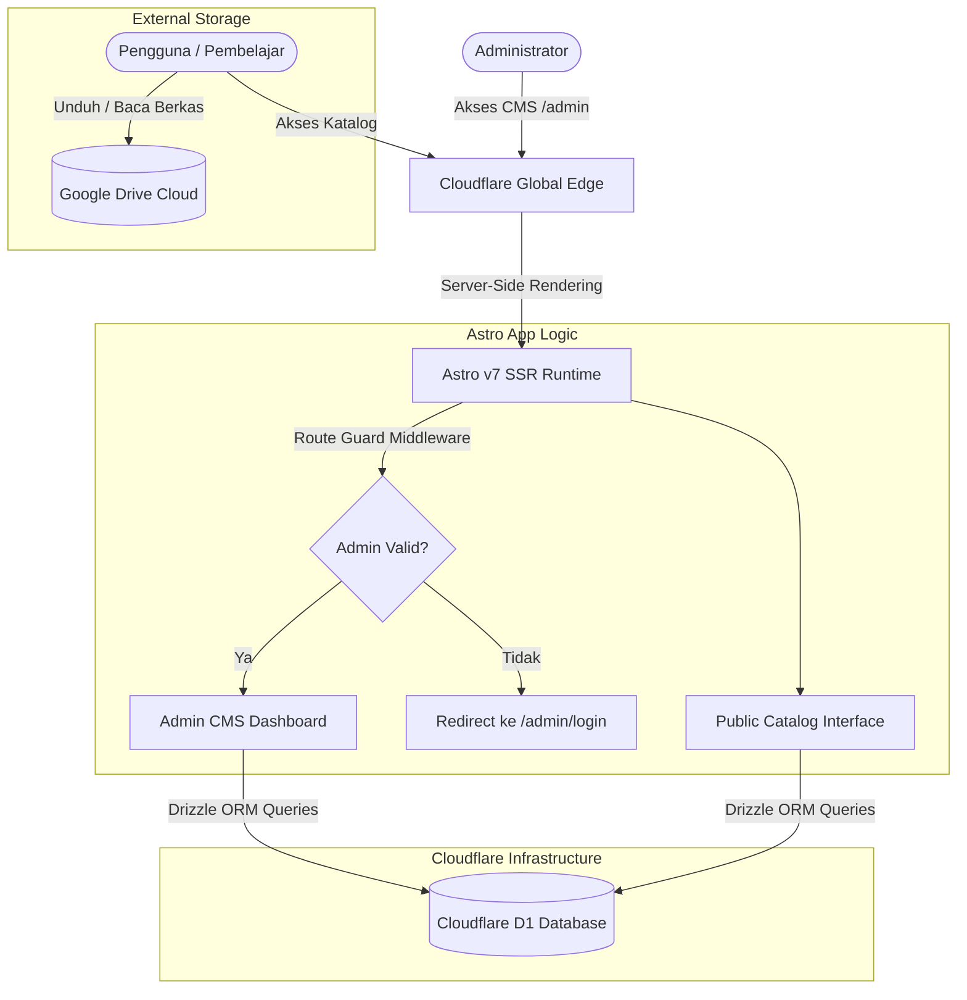

# Nihongo_repo (日本語レポ)

<p align="center">
  
</p>

<p align="center">
  <strong>Direktori Terkurasi Sumber Belajar & Buku Bahasa Jepang di Cloudflare Edge</strong>
</p>

<p align="center">
  <a href="https://astro.build"></a>
  <a href="https://pages.cloudflare.com"></a>
  <a href="https://developers.cloudflare.com/d1/"></a>
  <a href="https://tailwindcss.com"></a>
  <a href="https://playwright.dev"></a>
  <a href="https://opensource.org/licenses/MIT"></a>
</p>

---

## 📖 Tentang Proyek

**Nihongo_repo** (日本語レポ) adalah platform web katalog dan repositori materi pembelajaran bahasa Jepang (buku teks, tata bahasa, kanji, audio pemahaman, dan bank soal JLPT N5–N1) yang dibangun dengan standar performa tinggi. 

Dirancang dengan filosofi visual **Digital Washi & Sumi-e** (terinspirasi dari tekstur kertas tradisional Jepang dan kontras tinta kaligrafi), website ini menyajikan materi secara terstruktur, bebas iklan yang mengganggu, serta terhubung langsung ke berkas penyimpanan di **Google Drive**.

Selain antarmuka publik, proyek ini dilengkapi **Admin CMS** mandiri yang diproteksi autentikasi *edge-level session* untuk memudahkan penambahan dan kurasi materi secara visual tanpa coding manual.

---

## ✨ Fitur Utama

### 1. Katalog Publik (Public Catalog)
* **Latar Belakang Hero Artistik Kaligrafi Jepang:** Diperkaya dengan motif gelombang Seigaiha vektor SVG murni (0 HTTP request), lingkaran kuas Zen Ensō (円相), watermark kaligrafi raksasa 日本語, stempel merah Hanko, dan sepasang kaligrafi vertikal (*tategaki*) peribahasa belajar di layar desktop.
* **Pencarian Reaktif Instan:** Cari materi berdasarkan judul Latin, Romaji, Kanji Jepang asli, maupun nama pengarang seketika tanpa perlu memuat ulang halaman (Shortcut pencarian: <kbd>/</kbd>).
* **Filter Multifaset JLPT & Topik:**
  * **Level JLPT:** `N5 (Pemula)`, `N4 (Dasar Lanjutan)`, `N3 (Menengah)`, `N2 (Pra-Mahir)`, `N1 (Tingkat Mahir)`, dan `ALL (Semua Level / Materi Umum)`.
  * **Kategori Topik:** `Tata Bahasa (Bunpou)`, `Huruf & Kanji`, `Kosakata (Goi)`, `Membaca (Dokkai)`, `Menyimak & Audio (Choukai)`, dan `Bank Soal (Mondai)`.
* **Filter Cepat Tipe Media (Fast Format Chips):** Saring koleksi materi berdasarkan format berkas secara instan: Dokumen PDF (📄), Audio MP3 (🎧), Deck Anki (🎴), dan Lembar Latihan (📊) dengan badge visual pada setiap kartu.
* **Formulir Permintaan Buku & Pelaporan Tautan Rusak:** Modal interaktif dwitab ("Request Buku Baru" & "Lapor Link Rusak") yang dapat diakses langsung dari header navigasi dan modal detail materi (dengan auto-prefill judul/ID buku).
* **Sistem Bookmark Mandiri (*Favorites*):** Simpan materi favorit ke `localStorage` tanpa perlu registrasi/login, lengkap dengan tombol filter *"Tersimpan"* dan badge counter real-time.
* **Dua Mode Tampilan Fleksibel:** Beralih antara **Grid View** (kartu visual estetik) dan **Compact Table View** (tabel padat untuk pemindaian cepat puluhan buku).
* **Modal Detail Materi dengan PDF Preview:**
  * Tab 1: Ringkasan buku, penerbit, tahun rilis, dan ukuran berkas.
  * Tab 2: **Intip Isi Buku** (*Google Drive Preview Embed* iframe viewer langsung di dalam situs).
  * Tombol **Salin Link** (*one-click clipboard*), tautan langsung ke **Google Drive**, dan navigasi ke halaman penuh.
* **Halaman Rincian Mandiri (*Standalone Permalink* — `/materi/[id]`):** Halaman SEO SSR dengan OpenGraph metadata lengkap untuk sharing media sosial, breadcrumb navigasi, Web Share API, dan rekomendasi buku terkait.
* **Halaman Profil Pembuat (*About Page* — `/about`):** Halaman profil naratif pembuat/author, **avatar karakter interaktif (7 pose dinamis)** yang berganti pose seketika saat diklik, stempel segel merah Jepang "日", visi nirlaba proyek, teknologi di balik situs, dan tautan sosial GitHub.
* **Sensei Companion / Pendamping Belajar Interaktif:** Karakter Sensei mengambang di pojok kanan bawah seluruh halaman publik (menggunakan Avatar #7) yang membawakan 12 variasi kata mutiara, peribahasa (*kotowaza*), dan chat motivasi belajar (Kanji, Romaji, terjemahan Indonesia) yang berbeda setiap kali diklik.
* **Washi Night Mode (*Sumi-e Dark Mode*):** Dukungan tema terang kertas Washi dan tema gelap tinta arang Sumi-e dengan script anti-FOUC (Flash of Unstyled Content).
* **SEO, Sitemap & RSS Feed:** Dynamic XML Sitemap (`/sitemap.xml`) dan RSS 2.0 Feed (`/rss.xml`) untuk sindikasi konten dan auto-indexing.
* **Desain Responsif Adaptif (Mobile, Tablet, Desktop):** Drawer menu navigasi mobile yang rapi, bar filter sentuh horizontal tanpa overflow, target sentuhan jari minimal 44px, dan modal detail adaptif (berubah menjadi *bottom sheet* di smartphone dan kartu terpusat di tablet/desktop).
* **Tipografi Bersih & Elegan (Bebas Box AI Slop):** Tampilan metadata level JLPT (N5–N1) dan format materi disajikan dalam tipografi natural tanpa kotak-kotak badge berlebih yang mengganggu estetika.

### 2. Admin CMS Dashboard (`/admin`)
* **Keamanan Edge Middleware & Akses Tersembunyi:** Seluruh rute `/admin/*` diproteksi middleware server-side dengan session token terenkripsi HMAC-SHA256 (`HttpOnly` cookie). Tautan login disembunyikan total dari navbar dan footer publik sehingga akses CMS dilakukan manual via URL langsung (`/admin`).
* **Pengaturan Akun & Ganti Kata Sandi (`/admin/settings`):** Form ganti password aman dengan enkripsi Web Crypto PBKDF2 (SHA-256, 100.000 iterasi).
* **Ekspor & Impor Koleksi CSV:**
  * **Ekspor CSV (`/api/admin/materials/export`):** Unduh seluruh basis data materi lengkap ke format CSV dalam satu klik.
  * **Impor CSV (`/admin/materials/import`):** Unggah file CSV atau tempel teks langsung dengan auto-resolusi kategori dan level JLPT.
* **Mobile-First Admin Navigation:** Dilengkapi *sticky bottom navigation bar* pada layar ponsel/tablet untuk beralih instan antara Ringkasan Metrik, Kelola Materi, Tambah Buku, Kelola Kategori, dan Pengaturan.
* **Ringkasan Statistik Real-time:** Memantau total buku, total kategori, total klik Google Drive, serta grafik distribusi materi per tingkat JLPT.
* **Manajemen Materi (CRUD Lengkap):**
  * Form penambahan materi baru yang otomatis mengekstrak *File ID* dari URL berbagi Google Drive.
  * Dukungan berbagai format file: `PDF`, `AUDIO_ZIP`, `ANKI`, dan `EXCEL`.
  * Status kontrol publikasi (`Publik` vs `Draft`) dan penanda khusus *"Pilihan Sensei"* (*Featured*).
  * Form edit materi dan dialog modal konfirmasi sebelum menghapus data.
* **Manajemen Kategori:** Tambah dan atur urutan kategori dengan proteksi integritas relasi data (kategori tidak dapat dihapus jika masih menampung materi aktif).
* **Manajemen Permintaan & Laporan Link (`/admin/requests`):** Panel ringkasan metrik status (Menunggu Review, Request Buku Baru, Laporan Link Rusak, Selesai) dengan filter interaktif status/tipe dan kontrol aksi admin untuk merespons masukan pembelajar.

---

## 🏗️ Arsitektur Sistem



---

## 🛠️ Tech Stack & Ekosistem

* **Framework:** [Astro v7](https://astro.build/) (`^7.4.7`, `output: 'server'` dengan adapter `@astrojs/cloudflare` v14)
* **Hosting & Runtime:** [Cloudflare Pages](https://pages.cloudflare.com/) (V8 Edge Isolate)
* **Database:** [Cloudflare D1](https://developers.cloudflare.com/d1/) (Serverless SQL SQLite distributed globally)
* **ORM:** [Drizzle ORM](https://orm.drizzle.team/) + Drizzle Kit
* **Styling:** [Tailwind CSS v4](https://tailwindcss.com/) + `@lucide/astro`
* **Testing:** [Playwright](https://playwright.dev/) End-to-End Test Suite (Headless Chromium)
* **Keamanan:** Web Crypto API native (PBKDF2 SHA-256 password hash + HMAC session signature)
* **Desain Sistem:** Konsep *Digital Washi & Sumi-e* (Stitch Prototype Project ID: `407598114321150448`)

---

## 🚀 Memulai Secara Lokal (Local Development)

### 1. Prasyarat
* [Node.js](https://nodejs.org/) versi 20+ atau 22+
* npm versi 10+

### 2. Instalasi & Setup Proyek
```bash
# Masuk ke folder proyek
cd Projects/Web/nihongo_repo

# Install dependensi
npm install
```

### 3. Migrasi & Seeding Database D1 Lokal
```bash
# 1. Jalankan skema tabel database lokal
npx wrangler d1 execute nihongo-repo-db --local --file=./schema.sql

# 2. Masukkan data awal level JLPT, kategori, dan koleksi materi awal
npx wrangler d1 execute nihongo-repo-db --local --file=./src/db/seed.sql
```

### 4. Menjalankan Server Development
```bash
npm run dev
```
Buka browser pada alamat:
* **Katalog Publik:** `http://localhost:4321`
* **Admin CMS Login:** `http://localhost:4321/admin/login`
  * **Username:** `admin`
  * **Password:** `admin123`

---

## 🧪 Menjalankan Pengujian E2E (Playwright)

Proyek ini telah dilengkapi dengan suite pengujian otomatis end-to-end yang menguji alur pengguna publik dan admin secara menyeluruh:

```bash
# Jalankan seluruh skenario E2E test
npm run test:e2e
```

**Cakupan Skenario Uji (25/25 Passed - 100% Lulus):**
* ✅ Tampilan tema visual & branding Washi Paper
* ✅ Pencarian reaktif instan berdasarkan keyword
* ✅ Filter chip level JLPT (N5 - N1)
* ✅ Switcher tampilan Grid View & Table View
* ✅ Interaksi pop-up Modal Detail & Tab Pratinjau Dokumen Google Drive
* ✅ Penyimpanan Bookmark / Favorit ke `localStorage` & filter "Tersimpan"
* ✅ Pengalih Tema Dark Mode (Washi Light vs Sumi-e Dark)
* ✅ Pemuatan halaman permalink mandiri `/materi/[id]` & OpenGraph tags
* ✅ Validasi endpoint Dynamic XML Sitemap (`/sitemap.xml`) & RSS 2.0 Feed (`/rss.xml`)
* ✅ Pemuatan halaman profil pembuat `/about` (avatar, bio, story, visi & tautan sosial)
* ✅ Sensei companion di sudut kanan bawah dengan balon percakapan interaktif
* ✅ Sensei companion bebas digeser (*draggable*) di mobile dan desktop dengan orientasi adaptif
* ✅ Route guard redirection untuk akses yang belum terautentikasi
* ✅ Alur login admin dengan kredensial valid
* ✅ Navigasi admin, tabel materi, dan penambahan kategori
* ✅ Akses pengaturan ganti kata sandi admin & alat ekspor/impor CSV
* ✅ Drawer menu navigasi mobile pada layar smartphone (390x844)
* ✅ Bebas dari scroll horizontal berlebih (*zero horizontal scroll overflow*) di mobile
* ✅ Tampilan *sticky bottom navigation bar* admin di viewport mobile
* ✅ Tata letak responsif fluid pada layar tablet (768x1024)
* ✅ Filter cepat tipe format media (PDF & Audio MP3)
* ✅ Modal Request Buku & Lapor Link Mati dengan validasi formulir
* ✅ Review dan manajemen pengajuan pengguna di panel admin (`/admin/requests`)
* ✅ Pengaturan aksesibilitas ukuran font (A-, A, A+, A++) & 3 pilihan jenis font Jepang (Gothic, Mincho, Klee)
* ✅ Kontrol tipografi di drawer navigasi mobile dengan persistensi `localStorage` & anti-FOUC

---

## ⚡ Kinerja & Optimasi Kecepatan

* **Astro SSR di Cloudflare Edge:** Waktu muat awal ultra-responsif dengan TTFB rendah langsung dari edge node Cloudflare terdekat.
* **Zero-JS Baseline:** Bundle JavaScript klien produksi hanya **~4.2 KB** (~1.5 KB gzipped), bebas framework berat.
* **Aset Gambar WebP Terkompresi:** Avatar karakter dikonversi ke format WebP (penghematan 95%), dengan aset Sensei pendamping hanya **21 KB** (turun 98.1% dari 1,120 KB).
* **Paralel Database Query:** Menggunakan `Promise.all()` untuk mengeksekusi kueri D1 secara simultan.
* **Immutable Caching CDN:** Aturan `Cache-Control` jangka panjang pada `public/_headers` untuk aset statis permanen.
* **Zero Cumulative Layout Shift (CLS):** Atribut `width`, `height`, dan `decoding="async"` eksplisit pada seluruh gambar.

---

## ☁️ Panduan Deployment (GitHub ➔ Cloudflare Pages)

1. **Buat Database D1 di Cloudflare:**
   ```bash
   npx wrangler d1 create nihongo-repo-db
   ```
2. **Jalankan Migrasi & Seeding ke Production (Remote):**
   ```bash
   npx wrangler d1 execute nihongo-repo-db --remote --file=./schema.sql
   npx wrangler d1 execute nihongo-repo-db --remote --file=./src/db/seed.sql
   ```
3. **Hubungkan Repository ke Cloudflare Pages:**
   * Di Cloudflare Dashboard, pilih **Workers & Pages** > **Create application** > **Pages** > **Connect to Git**.
   * Pilih repository GitHub Anda.
   * **Build command:** `npm run build`
   * **Build output directory:** `dist`
   * **Environment variable:** `NODE_VERSION` = `22`
4. **Pasang Binding Database D1:**
   * Buka project Pages > **Settings** > **Functions** > **D1 Database Bindings**.
   * Tambahkan binding dengan nama variabel: `DB` dan arahkan ke database `nihongo-repo-db`.
   * Klik **Save** dan lakukan redeploy.

> 📖 Panduan lengkap dan troubleshooting operasional dapat dilihat di [`doc/DEPLOYMENT_GUIDE.md`](./doc/DEPLOYMENT_GUIDE.md).

---

## 📚 Direktori Dokumentasi Teknis

| Dokumen | Deskripsi |
| :--- | :--- |
| 📋 **[`doc/PRD.md`](./doc/PRD.md)** | *Product Requirements Document*: visi produk, audiens, dan fitur lengkap. |
| 🏗️ **[`doc/ARCHITECTURE.md`](./doc/ARCHITECTURE.md)** | Arsitektur teknis Astro SSR, Cloudflare Workers, dan middleware session. |
| 🗄️ **[`doc/DATABASE_SCHEMA.md`](./doc/DATABASE_SCHEMA.md)** | Diagram ERD Mermaid, skema tabel D1, dan seed SQL. |
| 🎨 **[`doc/DESIGN_RULES.md`](./doc/DESIGN_RULES.md)** | Panduan token warna, tipografi Noto Sans JP, dan aturan komponen UI. |
| 📅 **[`doc/IMPLEMENTATION_PLAN.md`](./doc/IMPLEMENTATION_PLAN.md)** | Riwayat eksekusi Fase 1 hingga Fase 7 (Semua fase telah selesai 100%). |
| 🚀 **[`doc/DEPLOYMENT_GUIDE.md`](./doc/DEPLOYMENT_GUIDE.md)** | Panduan lengkap langkah demi langkah deploy ke Cloudflare Pages. |

---

## 📄 Lisensi

Proyek ini dirilis di bawah lisensi [MIT](./LICENSE). Dibuat untuk mendukung komunitas pembelajar bahasa Jepang di seluruh dunia.
