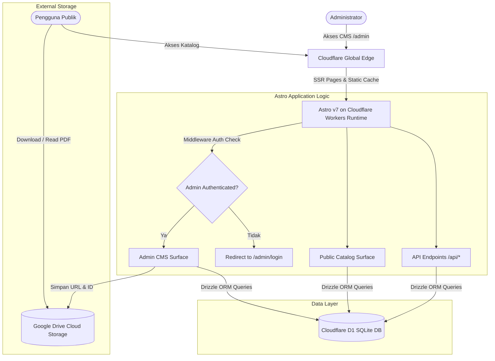

# Arsitektur & Tech Stack — Nihongo_repo

## 1. Diagram Arsitektur Sistem



---

## 2. Pemilihan Framework & Alur Autentikasi Admin

### 2.1 Mengapa Astro v7 untuk Publik + Admin CMS?
* **Satu Repositori Terpadu:** Tidak perlu memisahkan backend CMS dan frontend katalog publik. Astro mendukung SSR halaman dinamis dan form actions server-side langsung dalam satu project.
* **Server-Side Middleware:** Astro menyediakan file `src/middleware.ts` native yang dapat mengintersepsi setiap request ke `/admin/*` untuk memeriksa cookie token sesi admin sebelum merender halaman.
* **Zero Overhead:** Admin CMS dibangun dengan komponen Astro + Tailwind ringan tanpa framework state manajemen yang membengkak, memuat seketika di koneksi seluler.

### 2.2 Alur Keamanan & Autentikasi Admin
1. **Penyimpanan Kredensial:** Tabel `admin_users` menyimpan username dan password hash terenkripsi (PBKDF2 SHA-256 dengan 100.000 iterasi).
2. **Login Flow:**
   * Admin memasukkan username & password pada form `/admin/login`.
   * Server memverifikasi password via `verifyPassword()` dan mengenerate HMAC-SHA256 session token.
   * Token disimpan dalam cookie berstatus `HttpOnly`, `SameSite=Lax`, dan masa aktif 7 hari.
3. **Guard Middleware:**
   * Setiap request menuju `/admin` dan sub-routenya dicek oleh `src/middleware.ts`.
   * Jika cookie tidak valid, otomatis redirect ke `/admin/login`.

### 2.3 Integrasi Binding Cloudflare Workers Modern
Aplikasi menggunakan standar modern Cloudflare Workers (`cloudflare:workers` module):
* **Binding D1 (`DB`):**
  ```ts
  import { env } from 'cloudflare:workers';
  // env.DB adalah instance D1Database yang terhubung otomatis
  ```
  Pola ini menggantikan `Astro.locals.runtime.env` lama yang didepresiasi, memberikan koneksi langsung dan type-safe ke Cloudflare D1.
* **ORM Drizzle:** Diinisialisasi di `src/db/index.ts` via helper `getDb()`, menyederhanakan pemanggilan query di seluruh halaman Astro dan API endpoints.

---

## 3. Struktur Direktori Proyek

```text
nihongo_repo/
├── doc/                        # Dokumentasi teknis & desain
│   ├── README.md
│   ├── PRD.md
│   ├── ARCHITECTURE.md
│   ├── DATABASE_SCHEMA.md
│   ├── DESIGN_RULES.md
│   └── IMPLEMENTATION_PLAN.md
├── src/
│   ├── components/             # UI Components Publik & Admin
│   │   ├── Navbar.astro
│   │   ├── HeroSection.astro
│   │   ├── FilterChips.astro
│   │   ├── MaterialCard.astro
│   │   ├── MaterialDetailModal.astro
│   │   ├── SearchBar.tsx
│   │   └── admin/              # Komponen khusus Admin
│   │       ├── AdminSidebar.astro
│   │       ├── AdminNavbar.astro
│   │       ├── StatCard.astro
│   │       └── ConfirmDeleteModal.astro
│   ├── db/
│   │   ├── schema.ts           # Drizzle ORM schema (materials, categories, admin_users, dll.)
│   │   ├── index.ts            # D1 database client connector
│   │   └── seed.sql            # Initial seed data
│   ├── layouts/
│   │   ├── BaseLayout.astro    # Layout publik (Washi theme)
│   │   └── AdminLayout.astro   # Layout admin (Clean Operate theme)
│   ├── middleware.ts           # Route guard untuk /admin/*
│   ├── pages/
│   │   ├── index.astro         # Halaman utama publik
│   │   ├── level/[level].astro # Filter halaman per level JLPT
│   │   ├── admin/
│   │   │   ├── index.astro     # Dashboard overview metrik
│   │   │   ├── login.astro     # Form login admin
│   │   │   ├── logout.ts       # Endpoint pembersih cookie sesi
│   │   │   ├── materials/      # CRUD Materi (list, add, edit)
│   │   │   ├── categories/     # CRUD Kategori (list, add, edit)
│   │   │   └── tags/           # CRUD Tags
│   │   └── api/
│   │       ├── materials.json.ts
│   │       └── track-click.ts  # Pencatat metrik popularitas buku
│   └── styles/
│       └── global.css          # Tailwind CSS + Washi & Admin tokens
├── wrangler.jsonc              # Konfigurasi Cloudflare Pages & D1 binding
├── astro.config.mjs
└── package.json
```
