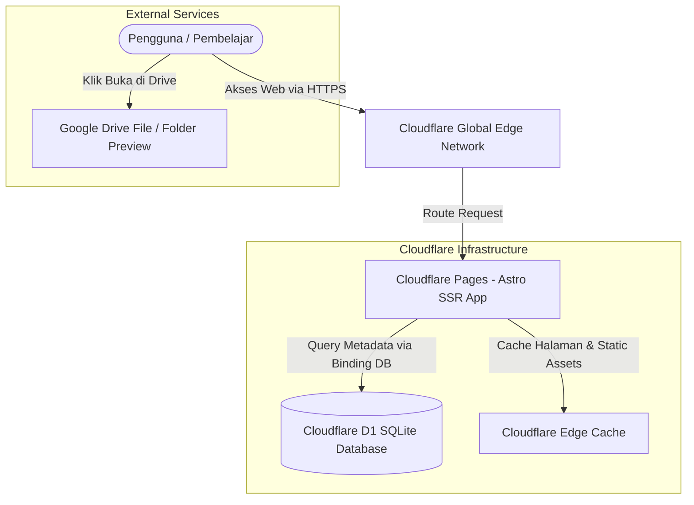

# Arsitektur & Tech Stack — Nihongo_repo

## 1. Diagram Arsitektur Sistem



---

## 2. Pemilihan Framework & Komponen

### 2.1 Mengapa Astro v5?
Website katalog materi pembelajaran memiliki karakteristik:
1. **Konten-sentris:** Membutuhkan SEO prima, halaman cepat terbuka, dan metadata yang ramah media sosial.
2. **Interaktivitas Terisolasi:** Hanya butuh interaktivitas kecil pada kolom pencarian dan tombol filter.
3. **Kompatibilitas Cloudflare:** Astro memiliki adapter resmi `@astrojs/cloudflare` yang sangat matang. Tidak seperti Next.js yang sering memerlukan polyfill Node.js runtime berat, Astro berjalan native di V8 isolate Cloudflare Workers.

### 2.2 Database: Cloudflare D1 + Drizzle ORM
* **Cloudflare D1:** Database SQLite serverless yang didistribusikan mendekati pengguna secara global dengan latensi rendah (<15ms di edge).
* **Drizzle ORM:** Dipilih karena:
  * Zero-dependencies & bundle size <50KB.
  * 100% type-safe TypeScript schema.
  * Migrasi otomatis yang mudah dijalankan via CLI `wrangler d1 migrations apply`.

### 2.3 Penyimpanan Materi: Google Drive Strategy
Karena database Cloudflare D1 difokuskan untuk metadata (judul, kategori, level, deskripsi), seluruh file berat (buku PDF 50MB–500MB, audio MP3) disimpan di Google Drive:
* **Format URL:** Menggunakan link publik berformat preview (`https://drive.google.com/file/d/{FILE_ID}/view?usp=sharing`).
* **Cover Thumbnails:** Dapat menggunakan thumbnail Google Drive beresolusi optimal atau link gambar cover eksternal yang di-cache di Cloudflare.

---

## 3. Struktur Direktori Proyek Rekomendasi

```text
nihongo_repo/
├── doc/                        # Dokumentasi teknis & desain
│   ├── README.md
│   ├── PRD.md
│   ├── ARCHITECTURE.md
│   ├── DATABASE_SCHEMA.md
│   ├── DESIGN_RULES.md
│   └── IMPLEMENTATION_PLAN.md
├── src/
│   ├── components/             # UI Components (Astro & Island components)
│   │   ├── Navbar.astro
│   │   ├── HeroSection.astro
│   │   ├── FilterChips.astro
│   │   ├── MaterialCard.astro
│   │   ├── MaterialDetailModal.astro
│   │   └── SearchBar.tsx       # Interactive search island
│   ├── db/
│   │   ├── schema.ts           # Drizzle ORM schema definition
│   │   └── index.ts            # D1 database client connector
│   ├── layouts/
│   │   └── BaseLayout.astro    # Layout utama dengan font Noto Sans JP
│   ├── pages/
│   │   ├── index.astro         # Halaman utama katalog
│   │   ├── level/[level].astro # Dynamic route per level JLPT
│   │   ├── api/
│   │   │   └── search.json.ts  # Endpoint API untuk pencarian
│   │   └── admin/              # Halaman input data sederhana
│   └── styles/
│       └── global.css          # Token warna Washi, Sumi-e & Tailwind
├── public/                     # Favicon, logo, font, placeholder images
├── astro.config.mjs            # Konfigurasi Astro + Cloudflare Adapter
├── wrangler.toml               # Konfigurasi Cloudflare Pages & D1 binding
├── package.json
└── tsconfig.json
```
