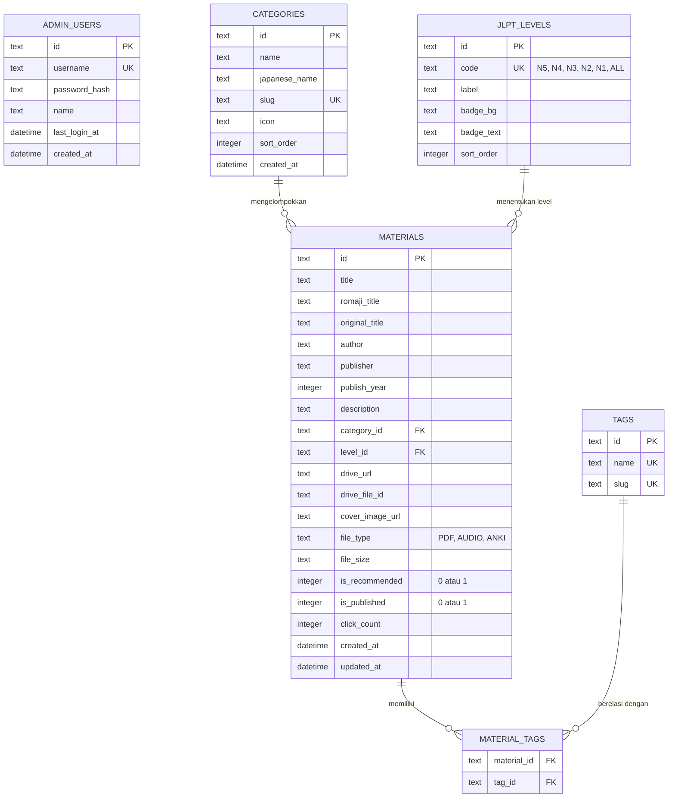

# Desain Skema Database (Cloudflare D1) — Nihongo_repo

## 1. Diagram Relasi Entitas (ERD)



---

## 2. Definisi Skema SQL D1 (`schema.sql`)

```sql
-- 1. Tabel Administrator (CMS Authentication)
CREATE TABLE IF NOT EXISTS admin_users (
    id TEXT PRIMARY KEY,
    username TEXT NOT NULL UNIQUE,
    password_hash TEXT NOT NULL,
    name TEXT,
    last_login_at DATETIME,
    created_at DATETIME DEFAULT CURRENT_TIMESTAMP
);

-- 2. Kategori Materi
CREATE TABLE IF NOT EXISTS categories (
    id TEXT PRIMARY KEY,
    name TEXT NOT NULL,
    japanese_name TEXT NOT NULL,
    slug TEXT NOT NULL UNIQUE,
    icon TEXT,
    sort_order INTEGER DEFAULT 0,
    created_at DATETIME DEFAULT CURRENT_TIMESTAMP
);

-- 3. Level JLPT
CREATE TABLE IF NOT EXISTS jlpt_levels (
    id TEXT PRIMARY KEY,
    code TEXT NOT NULL UNIQUE, -- 'N5', 'N4', 'N3', 'N2', 'N1', 'ALL'
    label TEXT NOT NULL,
    badge_bg TEXT NOT NULL,
    badge_text TEXT NOT NULL,
    sort_order INTEGER DEFAULT 0
);

-- 4. Data Materi Pembelajaran
CREATE TABLE IF NOT EXISTS materials (
    id TEXT PRIMARY KEY,
    title TEXT NOT NULL,
    romaji_title TEXT,
    original_title TEXT,
    author TEXT,
    publisher TEXT,
    publish_year INTEGER,
    description TEXT,
    category_id TEXT NOT NULL REFERENCES categories(id) ON DELETE RESTRICT,
    level_id TEXT NOT NULL REFERENCES jlpt_levels(id) ON DELETE RESTRICT,
    drive_url TEXT NOT NULL,
    drive_file_id TEXT,
    cover_image_url TEXT,
    file_type TEXT DEFAULT 'PDF',
    file_size TEXT,
    is_recommended INTEGER DEFAULT 0,
    is_published INTEGER DEFAULT 1,
    click_count INTEGER DEFAULT 0,
    created_at DATETIME DEFAULT CURRENT_TIMESTAMP,
    updated_at DATETIME DEFAULT CURRENT_TIMESTAMP
);

-- 5. Tag & Relasi
CREATE TABLE IF NOT EXISTS tags (
    id TEXT PRIMARY KEY,
    name TEXT NOT NULL UNIQUE,
    slug TEXT NOT NULL UNIQUE
);

CREATE TABLE IF NOT EXISTS material_tags (
    material_id TEXT NOT NULL REFERENCES materials(id) ON DELETE CASCADE,
    tag_id TEXT NOT NULL REFERENCES tags(id) ON DELETE CASCADE,
    PRIMARY KEY (material_id, tag_id)
);

-- Indeks Performa
CREATE INDEX IF NOT EXISTS idx_materials_category ON materials(category_id);
CREATE INDEX IF NOT EXISTS idx_materials_level ON materials(level_id);
CREATE INDEX IF NOT EXISTS idx_materials_title ON materials(title);
CREATE INDEX IF NOT EXISTS idx_materials_published ON materials(is_published);
```

---

## 3. Seed Data Awal (`seed.sql`)

```sql
-- Default Admin User (Password default di-hash, e.g. bcrypt/pbkdf2)
INSERT OR IGNORE INTO admin_users (id, username, password_hash, name) VALUES
('adm_master', 'admin', 'pbkdf2_sha256$nihongo_default_hash', 'Administrator Nihongo');

-- Insert Data Level JLPT
INSERT OR IGNORE INTO jlpt_levels (id, code, label, badge_bg, badge_text, sort_order) VALUES
('lvl_n5', 'N5', 'N5 (Pemula)', '#ECFDF5', '#065F46', 1),
('lvl_n4', 'N4', 'N4 (Dasar Lanjutan)', '#F0FDFA', '#115E59', 2),
('lvl_n3', 'N3', 'N3 (Menengah)', '#FFFBEB', '#92400E', 3),
('lvl_n2', 'N2', 'N2 (Pra-Mahir)', '#EEF2FF', '#3730A3', 4),
('lvl_n1', 'N1', 'N1 (Mahir)', '#FEF2F2', '#991B1B', 5),
('lvl_all', 'ALL', 'Semua Level', '#F5F5F4', '#44403C', 6);

-- Insert Data Kategori
INSERT OR IGNORE INTO categories (id, name, japanese_name, slug, icon, sort_order) VALUES
('cat_grammar', 'Tata Bahasa', '文法 (Bunpou)', 'grammar', 'book-open', 1),
('cat_kanji', 'Huruf & Kanji', '漢字 (Kanji)', 'kanji', 'pen-tool', 2),
('cat_vocab', 'Kosakata', '語彙 (Goi)', 'vocab', 'layers', 3),
('cat_reading', 'Membaca', '読解 (Dokkai)', 'reading', 'file-text', 4),
('cat_listening', 'Menyimak & Audio', '聴解 (Choukai)', 'listening', 'headphones', 5),
('cat_exam', 'Bank Soal JLPT', '問題集 (Mondai)', 'exam', 'check-circle', 6);

-- Insert Contoh Materi Minna no Nihongo
INSERT OR IGNORE INTO materials (
    id, title, romaji_title, original_title, author, publisher, publish_year,
    description, category_id, level_id, drive_url, file_type, file_size, is_recommended, is_published, click_count
) VALUES (
    'mat_minna1',
    'Minna no Nihongo Shokyu I (Second Edition)',
    'Minna no Nihongo Shokyu 1',
    'みんなの日本語 初級I 第2版 本冊',
    '3A Corporation',
    '3A Corporation',
    2012,
    'Buku teks standar utama pembelajaran bahasa Jepang tingkat pemula (Bab 1 - Bab 25). Memuat tata bahasa dasar, pola kalimat, dan latihan komprehensif.',
    'cat_grammar',
    'lvl_n5',
    'https://drive.google.com/file/d/sample-file-id/view?usp=sharing',
    'PDF',
    '45 MB',
    1,
    1,
    128
);
```
