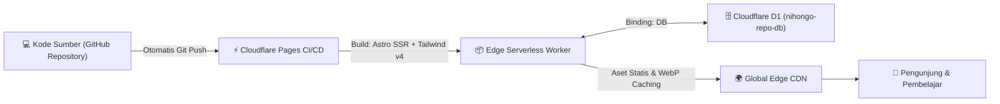

# 🚀 Panduan Lengkap Deployment Cloudflare Pages & D1 — Nihongo_repo

Dokumen ini memuat panduan komprehensif langkah demi langkah untuk mendeploy website **Nihongo_repo** ke jaringan edge global **Cloudflare Pages** dengan database serverless **Cloudflare D1 (SQLite)**.

---

## 🗺️ Alur Arsitektur Deployment



---

## 📋 1. Prasyarat (Prerequisites)

Sebelum memulai, pastikan Anda memiliki:
1. **Akun Cloudflare:** Daftar gratis di [dash.cloudflare.com](https://dash.cloudflare.com/).
2. **Repository GitHub:** Kode proyek sudah berada di repository GitHub Anda (`https://github.com/cirilalacture/Nihongo-Repo.git`).
3. **Node.js:** Versi 20+ atau 22+ terinstal di komputer.
4. **Wrangler CLI:** Login ke akun Cloudflare melalui terminal komputer:
   ```bash
   npx wrangler login
   ```
   *(Browser akan terbuka untuk konfirmasi otorisasi akses).*

---

## 🗄️ 2. Langkah 1: Buat Database D1 di Cloudflare

Cloudflare D1 adalah database relasional SQLite serverless berlatensi sangat rendah di edge.

Jalankan perintah berikut di terminal:
```bash
npx wrangler d1 create nihongo-repo-db
```

Output terminal akan menampilkan detail konfigurasi database:
```text
✅ Successfully created DB 'nihongo-repo-db'!

[[d1_databases]]
binding = "DB"
database_name = "nihongo-repo-db"
database_id = "xxxxxxxx-xxxx-xxxx-xxxx-xxxxxxxxxxxx"
```

> 💡 **Catatan:** Salin nilai `database_id` yang Anda dapatkan (deretan UUID seperti `a1b2c3d4-...`), lalu buka file [`wrangler.jsonc`](../wrangler.jsonc) dan perbarui bagian `database_id`:
> ```json
> "d1_databases": [
>   {
>     "binding": "DB",
>     "database_name": "nihongo-repo-db",
>     "database_id": "PASTE_DATABASE_ID_ANDA_DI_SINI"
>   }
> ]
> ```

---

## 📦 3. Langkah 2: Jalankan Migrasi Skema & Seeding Data Awal

Eksekusi skema tabel D1 dan koleksi data kurasi awal ke database Cloudflare **production** menggunakan flag `--remote`:

### A. Migrasi Skema Tabel (`schema.sql`):
```bash
npx wrangler d1 execute nihongo-repo-db --remote --file=./schema.sql
```
*Perintah ini membuat tabel `admin_users`, `categories`, `jlpt_levels`, `materials`, `material_tags`, dan `material_requests` lengkap dengan indeks performa.*

### B. Masukkan Data Awal / Seeding (`src/db/seed.sql`):
```bash
npx wrangler d1 execute nihongo-repo-db --remote --file=./src/db/seed.sql
```
*Perintah ini mengisi level JLPT (N5–N1), kategori buku, dan materi kurasi awal lengkap.*

### C. Verifikasi Database Remote:
```bash
npx wrangler d1 execute nihongo-repo-db --remote --command="SELECT count(*) as total_materi FROM materials;"
```
Jika menampilkan angka (misalnya `9` atau lebih), database production Anda telah aktif dan siap!

---

## ☁️ 4. Langkah 3: Hubungkan Repository ke Cloudflare Pages

1. Buka [Cloudflare Dashboard](https://dash.cloudflare.com/).
2. Pada menu navigasi sebelah kiri, pilih **Workers & Pages**.
3. Klik tombol **Create application** ➔ pilih tab **Pages** ➔ klik **Connect to Git**.
4. Pilih akun GitHub Anda dan pilih repository: **`Nihongo-Repo`**.
5. Pada halaman **Set up builds and deployments**, atur parameter berikut:
   - **Project name:** `nihongo-repo` (atau nama pilihan Anda)
   - **Production branch:** `main`
   - **Framework preset:** `Astro`
   - **Build command:** `npm run build`
   - **Build output directory:** `dist`
   - **Root directory:** `/` (biarkan kosong / default)
6. Buka bagian **Environment variables (advanced)** dan tambahkan variabel Node:
   - **Variable name:** `NODE_VERSION`
   - **Value:** `22`
7. Klik tombol **Save and Deploy**.

*(Cloudflare akan menjalankan proses build pertama selama ~1–2 menit).*

---

## 🔗 5. Langkah 4: Hubungkan Binding Database D1 (Wajib)

Agar aplikasi Astro SSR yang berjalan di serverless worker dapat membaca database D1 di production, Anda wajib memasang binding:

1. Di Cloudflare Dashboard, buka project Pages yang baru dibuat (**nihongo-repo**).
2. Masuk ke tab **Settings** ➔ klik menu **Functions** di sebelah kiri.
3. Gulir ke bawah ke bagian **D1 Database Bindings**.
4. Klik tombol **Add binding**:
   - **Variable name:** `DB` *(Wajib menggunakan huruf kapital `DB` persis sesuai kode sumber).*
   - **D1 database:** Pilih **`nihongo-repo-db`** dari dropdown.
5. Klik **Save**.
6. **Lakukan Deploy Ulang:**
   - Masuk ke tab **Deployments**.
   - Pada deployment terakhir, klik tombol titik tiga (`...`) di kanan ➔ pilih **Retry deployment**.
   - Atau lakukan commit baru di repository Anda untuk memicu build otomatis.

---

## 🔐 6. Langkah 5: Login & Pengamanan Admin CMS Production

Setelah deployment selesai, website Anda dapat diakses di domain bawaan: `https://nihongo-repo.pages.dev`.

1. **Akses Login Admin:**
   Buka URL:
   ```text
   https://nihongo-repo.pages.dev/admin/login
   ```
2. **Kredensial Default:**
   - **Username:** `admin`
   - **Password:** `admin123`
3. **Segera Ganti Password Admin di Production:**
   - Setelah masuk ke dashboard, navigasi ke menu **Pengaturan** (`/admin/settings`).
   - Masukkan password lama (`admin123`) dan buat password baru yang kuat.
   - Sistem akan otomatis mengenkripsi password baru menggunakan Web Crypto PBKDF2 (SHA-256 dengan 100.000 iterasi) langsung ke database D1.

---

## 🌐 7. Langkah 6 (Opsional): Pasang Custom Domain

Jika Anda memiliki domain pribadi (misal: `nihongo.domainanda.com`):
1. Di project Cloudflare Pages Anda, buka tab **Custom domains**.
2. Klik **Set up a custom domain**.
3. Masukkan nama domain atau subdomain Anda.
4. Cloudflare akan secara otomatis mengelola DNS dan menerbitkan **Sertifikat SSL (HTTPS)** gratis.

---

## 🛠️ 8. Operasional Harian & Pemeliharaan

### A. Menambah & Mengelola Buku
- Cukup buka `/admin/materials/new` dari browser HP atau laptop.
- Masukkan judul, kategori, level JLPT, link Google Drive, dan simpan.

### B. Meninjau Permintaan Pengguna & Laporan Link
- Buka `/admin/requests` untuk memantau request buku baru atau laporan link Google Drive yang bermasalah dari pembaca.

### C. Cadangkan Data (Backup Database D1)
Jalankan perintah ini sewaktu-waktu di terminal komputer untuk mencadangkan database remote:
```bash
npx wrangler d1 export nihongo-repo-db --remote --output=./backup-nihongo-$(date +%F).sql
```

### D. Ekspor Koleksi ke Format CSV
- Di panel admin `/admin/materials`, klik tombol **"Ekspor CSV"** untuk mengunduh seluruh katalog dalam berkas spreadsheet `.csv`.

---

## ❓ FAQ & Solusi Kendala (Troubleshooting)

| Kendala | Penyebab | Solusi |
| :--- | :--- | :--- |
| **Error: `D1_ERROR` / Database tidak ditemukan** | Binding `DB` belum dipasang di dashboard Pages | Buka Settings ➔ Functions ➔ D1 Database Bindings ➔ Tambahkan `DB` mengarah ke `nihongo-repo-db`, lalu klik *Retry deployment*. |
| **Build Gagal: `Node version mismatch`** | Cloudflare Pages menggunakan versi Node default lama | Pastikan Environment Variable `NODE_VERSION` diset ke `22` di Settings ➔ Environment variables. |
| **Gambar avatar lambat diakses** | Cache browser belum aktif | Website sudah menyertakan `public/_headers` dengan konfigurasi `max-age=31536000, immutable`. Cloudflare CDN akan menyimpannya secara permanen setelah request pertama. |
