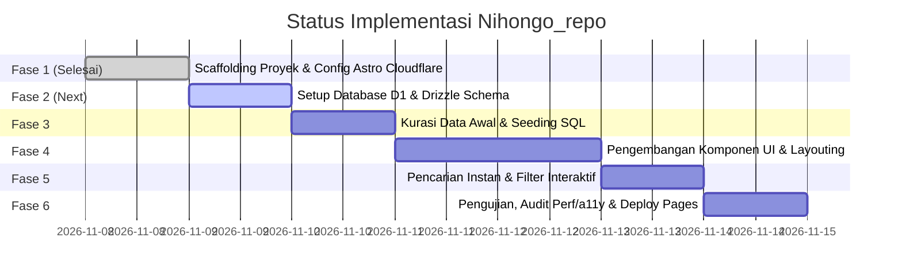

# Implementation Plan — Nihongo_repo

Dokumen ini memuat jadwal, status pengerjaan saat ini, dan panduan langkah demi langkah untuk membangun dan mendeploy **Nihongo_repo** ke Cloudflare Pages dengan database Cloudflare D1.

> **STATUS PROGRES TERKINI (Updated: 2026-11-08):**
> * [x] **Fase 1: Scaffolding Proyek & Konfigurasi Cloudflare** — `SELESAI (Completed)`
> * [ ] **Fase 2: Setup Database D1 & Drizzle Schema** — `BERIKUTNYA (Next Up)`
> * [ ] **Fase 3: Kurasi Data Awal & Seeding SQL** — `Menunggu`
> * [ ] **Fase 4: Pengembangan Komponen UI & Desain Impeccable** — `Menunggu`
> * [ ] **Fase 5: Pencarian Instan & Filter Interaktif** — `Menunggu`
> * [ ] **Fase 6: Pengujian, Audit Perf/a11y & Deploy Pages** — `Menunggu`

---

## 📅 Roadmap Tahapan Pengembangan



---

## 🛠 Rincian Teknis Tiap Fase

### [x] Fase 1: Scaffolding Proyek & Konfigurasi Cloudflare (STATUS: SELESAI)
- [x] Inisialisasi Astro v5 di direktori `nihongo_repo`.
- [x] Konfigurasi Cloudflare adapter (`@astrojs/cloudflare` v14) dengan mode SSR `output: 'server'`.
- [x] Konfigurasi Tailwind CSS v4 via `@tailwindcss/vite` di `astro.config.mjs`.
- [x] Konfigurasi tema warna Digital Washi & Sumi-e di `src/styles/global.css`.
- [x] Instalasi dependensi: `drizzle-orm`, `@lucide/astro`, `wrangler`, `drizzle-kit`.
- [x] Konfigurasi `wrangler.jsonc` dengan binding D1 `DB` dan compatibility flags `nodejs_compat`.
- [x] Pengujian build: `npm run build` sukses 100% tanpa error (`dist/` generated).

---

### [ ] Fase 2: Setup Database Cloudflare D1 & Drizzle (STATUS: BERIKUTNYA)
1. Buat file `wrangler.toml` dengan binding D1:
   ```toml
   name = "nihongo-repo"
   compatibility_date = "2024-09-23"
   compatibility_flags = ["nodejs_compat"]

   [[d1_databases]]
   binding = "DB"
   database_name = "nihongo-repo-db"
   database_id = "xxxxxxxx-xxxx-xxxx-xxxx-xxxxxxxxxxxx" # Dibuat via wrangler d1 create
   ```
2. Buat skema Drizzle di `src/db/schema.ts` yang merefleksikan tabel `categories`, `jlpt_levels`, `materials`, dan `tags`.
3. Buat database D1 lokal untuk development:
   ```bash
   npx wrangler d1 execute nihongo-repo-db --local --file=./doc/DATABASE_SCHEMA.md
   ```

---

### Fase 3: Kurasi Data Awal & Google Drive Linking
1. Buat file seeder `src/db/seed.sql` berisi buku-buku referensi utama:
   * **N5:** Minna no Nihongo I, Genki I, Kanji Look and Learn.
   * **N4:** Minna no Nihongo II, Genki II.
   * **N3:** Shin Kanzen Master Bunpou N3, Sou Matome Goi N3.
   * **N2:** Shin Kanzen Master N2, Nihongo Sou Matome N2.
   * **N1:** Shin Kanzen Master N1.
2. Pastikan file tersimpan di folder Google Drive publik dan format link preview telah siap (`/view?usp=sharing`).

---

### Fase 4: Pembangunan Komponen UI & Desain Visual
1. Konfigurasikan token warna di `tailwind.config.mjs` atau `src/styles/global.css`:
   * Warna Washi, Sumi Ink, dan Shu-iro Vermilion.
2. Buat komponen UI:
   * `src/components/Navbar.astro`
   * `src/components/HeroSection.astro`
   * `src/components/FilterBar.astro`
   * `src/components/MaterialCard.astro`
   * `src/components/MaterialModal.astro`
   * `src/components/Footer.astro`
3. Susun halaman utama di `src/pages/index.astro`.

---

### Fase 5: Pencarian Instan & Filter Interaktif (Client Island)
1. Buat komponen pencarian reaktif (React Island atau Vanilla TS) di `src/components/SearchBar.tsx`.
2. Pengguna dapat mengetik judul atau menekan tombol filter level JLPT (N5-N1) untuk menyaring kartu materi secara instan tanpa reload browser.
3. Tambahkan URL query parameter sync (`?level=N3&q=kanzen`) agar hasil filter bisa dibagikan (*shareable URL*).

---

### Fase 6: Testing, Audit Kualitas & Deployment
1. Jalankan testing build dan runtime lokal:
   ```bash
   npm run build
   npx wrangler pages dev ./dist
   ```
2. Audit tampilan dengan kriteria **Impeccable**:
   * Responsivitas pada ukuran layar Mobile (375px), Tablet (768px), dan Desktop (1440px).
   * Keterbacaan teks dan rasio kontras warna.
3. Hubungkan repository GitHub ke **Cloudflare Pages**:
   * Build command: `npm run build`
   * Output directory: `dist`
   * Hubungkan binding database D1 production di pengaturan Pages.
