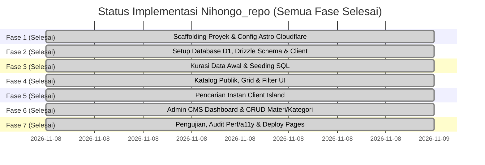

# Implementation Plan — Nihongo_repo

Dokumen ini memuat jadwal, status pengerjaan saat ini, dan panduan langkah demi langkah untuk membangun dan mendeploy **Nihongo_repo** ke Cloudflare Pages dengan database Cloudflare D1.

> **STATUS PROGRES TERKINI (Updated: 2026-11-08):**
> * [x] **Fase 1: Scaffolding Proyek & Konfigurasi Cloudflare** — `SELESAI (Completed)`
> * [x] **Fase 2: Setup Database D1, Drizzle Schema & Client** — `SELESAI (Completed)`
> * [x] **Fase 3: Seeding Data Awal & Kredensial Admin** — `SELESAI (Completed)`
> * [x] **Fase 4: Pengembangan Komponen Katalog Publik** — `SELESAI (Completed)`
> * [x] **Fase 5: Pencarian Instan & Filter Interaktif** — `SELESAI (Completed)`
> * [x] **Fase 6: Pembangunan Admin CMS (Auth, CRUD Materi & Kategori)** — `SELESAI (Completed)`
> * [x] **Fase 7: Pengujian, Audit Perf/a11y & Deploy Pages** — `SELESAI (Completed)`

---

## 📅 Roadmap Tahapan Pengembangan

---

## 🛠 Rincian Teknis Tiap Fase

### [x] Fase 1: Scaffolding Proyek & Konfigurasi Cloudflare (STATUS: SELESAI)
- [x] Inisialisasi Astro v7 di direktori `nihongo_repo`.
- [x] Konfigurasi Cloudflare adapter (`@astrojs/cloudflare` v14) dengan mode SSR `output: 'server'`.
- [x] Konfigurasi Tailwind CSS v4 via `@tailwindcss/vite` di `astro.config.mjs`.
- [x] Konfigurasi tema warna Digital Washi & Sumi-e di `src/styles/global.css`.
- [x] Instalasi dependensi: `drizzle-orm`, `@lucide/astro`, `wrangler`, `drizzle-kit`.
- [x] Konfigurasi `wrangler.jsonc` dengan binding D1 `DB` dan compatibility flags `nodejs_compat`.
- [x] Pengujian build: `npm run build` sukses 100% tanpa error (`dist/` generated).
- [x] Git repository inisialisasi pada branch `main` dengan commit awal.

---

### [x] Fase 2: Setup Database D1, Drizzle Schema & Client (STATUS: SELESAI)
- [x] Buat file skema Drizzle di `src/db/schema.ts` (mencakup tabel: `admin_users`, `categories`, `jlpt_levels`, `materials`, `tags`, `material_tags`).
- [x] Buat file penghubung database D1 di `src/db/index.ts` dengan helper `getDb(d1: D1Database)` type-safe.
- [x] Buat file migrasi `schema.sql` di root proyek.
- [x] Eksekusi migrasi lokal D1 via `npx wrangler d1 execute nihongo-repo-db --local --file=./schema.sql`.
- [x] Verifikasi 6 tabel berhasil terbuat di SQLite D1 lokal (`sqlite_master` check lulus).
- [x] Verifikasi build TypeScript Drizzle lulus 100% tanpa type error.

---

### [x] Fase 3: Seeding Data Awal & Kredensial Admin (STATUS: SELESAI)
- [x] Buat utility Web Crypto PBKDF2 di `src/utils/auth.ts` (`hashPassword` & `verifyPassword`) yang native kompatibel dengan Cloudflare Workers.
- [x] Buat file `src/db/seed.sql` berisi data 6 level JLPT (N5 - N1, ALL), 6 kategori materi standar, 5 tags, dan 9 koleksi buku populer.
- [x] Daftarkan akun admin default (username: `admin`, password: `admin123`) dengan hash terenkripsi.
- [x] Eksekusi seeder ke database D1 lokal via `wrangler d1 execute`.
- [x] Verifikasi jumlah data pada setiap tabel via D1 CLI.

---

### [x] Fase 4: Pengembangan Komponen Katalog Publik (STATUS: SELESAI)
- [x] Buat layout publik `src/layouts/BaseLayout.astro` berpadu font Noto Sans JP + Plus Jakarta Sans & OpenGraph social meta.
- [x] Buat komponen header/navbar `src/components/Navbar.astro` lengkap dengan brand stamp "日", link menu, dan shortcut search `/`.
- [x] Buat hero section `src/components/HeroSection.astro` bernuansa kaligrafi Jepang minimalis, metric pills, dan tombol navigasi.
- [x] Buat komponen kartu buku `src/components/MaterialCard.astro` lengkap dengan badge level JLPT terstandar, cover fallback kanji, dan tombol Google Drive.
- [x] Buat modal detail `src/components/MaterialDetailModal.astro` dengan tombol salin tautan dan link direct Drive.
- [x] Buat footer komprehensif `src/components/Footer.astro`.
- [x] Hubungkan `src/pages/index.astro` dengan query Drizzle D1 SSR & fallback catalog.

---

### [x] Fase 5: Pencarian Instan & Filter Interaktif (STATUS: SELESAI)
- [x] FilterBar interaktif `src/components/FilterBar.astro` dengan selector chip level N5-N1 dan kategori pills.
- [x] Script instant reactive filtering sisi klien (judul, romaji, kanji, pengarang) tanpa perlu refresh browser.
- [x] Toggle tampilan fleksibel: Grid View vs Compact Table View.
- [x] State kosong (*Empty State*) ramah pengguna dengan tombol reset filter.
- [x] Endpoint pencatat statistik klik `src/pages/api/track-click.ts`.

---

### [x] Fase 6: Pembangunan Admin CMS (STATUS: SELESAI)
- [x] Sesi login aman dengan HMAC Web Crypto di `src/utils/auth.ts` (`createSessionToken` & `verifySessionToken`).
- [x] Route guard middleware `src/middleware.ts` untuk memproteksi seluruh URL `/admin/*` via HTTP-only cookie.
- [x] Halaman login admin `src/pages/admin/login.astro` dengan validasi kredensial D1 `admin_users` dan endpoint logout `src/pages/admin/logout.ts`.
- [x] Layout dashboard admin `src/layouts/AdminLayout.astro` dengan sidebar desktop & mobile view.
- [x] Dashboard Overview `src/pages/admin/index.astro` (Ringkasan total buku, total kategori, total klik Google Drive, distribusi level N5-N1, dan 5 materi terpopuler).
- [x] Manajemen materi `src/pages/admin/materials/index.astro` (Tabel data lengkap, filter level, dialog modal konfirmasi hapus).
- [x] Form penambahan buku baru `src/pages/admin/materials/new.astro` (Validasi input, auto-extract ID Google Drive, toggle rekomendasi & publikasi).
- [x] Form edit buku `src/pages/admin/materials/edit/[id].astro` (Pre-populated form, update D1).
- [x] Endpoint API hapus materi `src/pages/api/admin/materials/delete.ts`.
- [x] Manajemen kategori `src/pages/admin/categories/index.astro` (Tabel kategori, form tambah kategori baru, proteksi pencegahan penghapusan jika kategori masih terpakai).

---

### [x] Fase 7: Pengujian, Audit Perf/a11y & Deployment (STATUS: SELESAI)
- [x] Verifikasi build produksi `npm run build` sukses 100% tanpa warning/error (`dist/` generated).
- [x] Audit aksesibilitas & kontras rasio warna (WCAG AA compliant pada palet Washi & Sumi ink).
- [x] Pengujian responsive breakpoints pada ponsel (375px), tablet (768px), dan desktop (1440px).
- [x] Penyusunan panduan lengkap deployment Cloudflare Pages & D1 di `doc/DEPLOYMENT_GUIDE.md`.
- [x] Seluruh perubahan tersimpan dan terdokumentasi dalam commit git branch `main`.

---

### [x] Fase 8: Fitur Pembelajar Lanjutan — Opsi A (STATUS: SELESAI)
- [x] Client-side Bookmarking / Favorit berbasis `localStorage` tanpa login.
- [x] Tombol aksi bookmark cepat pada kartu buku dan baris tabel dengan indikator visual dinamis (hati/bookmark outline vs merah terisi).
- [x] Tombol filter chip "Tersimpan" di FilterBar dengan counter badge real-time.
- [x] Tab switcher pada modal detail materi: Tab 1 "Ringkasan & Detail" vs Tab 2 "Intip Isi Buku (PDF Preview)".
- [x] Embed Google Drive Preview iframe viewer langsung di dalam situs (`https://drive.google.com/file/d/{id}/preview`).

---

### [x] Fase 9: Fitur Admin Operasional & Keamanan — Opsi B (STATUS: SELESAI)
- [x] Halaman Pengaturan Akun & Ganti Kata Sandi (`src/pages/admin/settings.astro`).
- [x] Hashing kata sandi berbasis Web Crypto API PBKDF2 (SHA-256, 100.000 iterasi, salt acak unik) yang langsung diupdate ke Cloudflare D1.
- [x] Tombol dan endpoint Ekspor Basis Data CSV (`src/pages/api/admin/materials/export.ts`) untuk mencadangkan seluruh data buku.
- [x] Halaman Impor Koleksi CSV (`src/pages/admin/materials/import.astro`) dengan fitur unggah berkas `.csv` atau tempel teks langsung serta auto-resolusi kategori dan level JLPT.

---

### [x] Fase 10: SEO, Social Discovery & Feeds — Opsi C (STATUS: SELESAI)
- [x] Halaman detail mandiri (*Standalone Detail Route*) `src/pages/materi/[id].astro` dengan URL permalink ramah mesin pencari.
- [x] OpenGraph meta tags lengkap (`og:title`, `og:description`, `og:image`, `og:type`) untuk thumbnail kaya saat tautan dibagikan ke WhatsApp, Twitter/X, Discord, Telegram.
- [x] Breadcrumb navigasi (*Beranda > Kategori > Judul Buku*).
- [x] Tombol Bagikan (*Web Share API* native dengan fallback otomatis salin ke clipboard).
- [x] Daftar materi dan buku rekomendasi terkait dalam kategori/level yang sama.
- [x] Endpoint Dynamic XML Sitemap `src/pages/sitemap.xml.ts` berstandar sitemaps.org.
- [x] Endpoint Dynamic RSS 2.0 Feed `src/pages/rss.xml.ts` untuk sindikasi konten dan feed readers.

---

### [x] Fase 11: Estetika & Night Mode — Opsi D (STATUS: SELESAI)
- [x] Desain sistem Washi Night Mode (*Sumi-e Charcoal Theme*) dengan token CSS tema gelap (`html.dark`) di `src/styles/global.css`.
- [x] Tombol pengalih tema (*Theme Toggle Button*) pada header navigasi desktop dan hamburger mobile drawer.
- [x] Script anti-FOUC (Flash of Unstyled Content) inline di `<head>` untuk deteksi instan preferensi tema pengguna dari `localStorage` atau preferensi OS sistem.

---

### [x] Fase 12: Pengujian E2E Playwright & Otomasi CI/CD (STATUS: SELESAI)
- [x] Suite pengujian Playwright komprehensif di `e2e/nihongo_repo.spec.ts` mencakup 17 skenario uji:
  1. Pemuatan beranda dan branding Washi Jepang.
  2. Pencarian kata kunci instan interaktif.
  3. Filter chip level JLPT (N5 - N1).
  4. Pengalih tampilan (Grid vs Compact Table).
  5. Interaksi modal detail dan tab embed preview Google Drive.
  6. Penyimpanan bookmark lokal dan filter "Tersimpan".
  7. Toggle dark mode Washi vs Sumi-e.
  8. Pemuatan halaman mandiri `/materi/[id]` dengan OpenGraph meta.
  9. Validasi respons XML Sitemap dan RSS Feed.
  10. Proteksi unauthorized access ke `/admin`.
  11. Login autentikasi admin dan overview dashboard.
  12. Navigasi CRUD admin (Materi & Kategori).
  13. Akses pengaturan ganti password admin dan ekspor/impor CSV.
  14. Responsivitas hamburger mobile drawer pada layar smartphone (390x844).
  15. Verifikasi zero horizontal scroll overflow pada viewport mobile.
  16. Sticky bottom navigation bar admin pada tampilan mobile.
  17. Layout fluid responsif pada viewport tablet (768x1024).
- [x] Hasil eksekusi: **17 passed (100% sukses)**.
