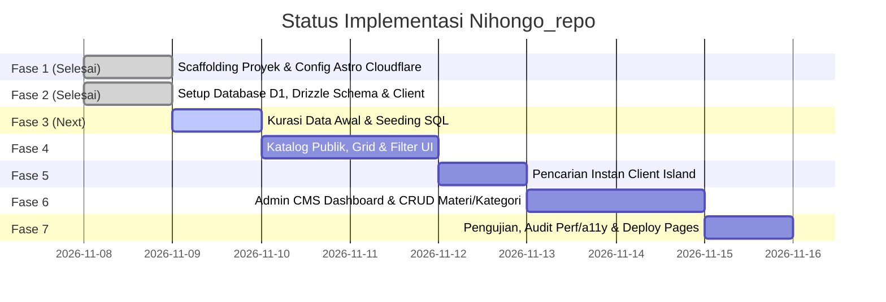

# Implementation Plan — Nihongo_repo

Dokumen ini memuat jadwal, status pengerjaan saat ini, dan panduan langkah demi langkah untuk membangun dan mendeploy **Nihongo_repo** ke Cloudflare Pages dengan database Cloudflare D1.

> **STATUS PROGRES TERKINI (Updated: 2026-11-08):**
> * [x] **Fase 1: Scaffolding Proyek & Konfigurasi Cloudflare** — `SELESAI (Completed)`
> * [x] **Fase 2: Setup Database D1, Drizzle Schema & Client** — `SELESAI (Completed)`
> * [ ] **Fase 3: Seeding Data Awal & Kredensial Admin** — `BERIKUTNYA (Next Up)`
> * [ ] **Fase 4: Pengembangan Komponen Katalog Publik** — `Menunggu`
> * [ ] **Fase 5: Pencarian Instan & Filter Interaktif** — `Menunggu`
> * [ ] **Fase 6: Pembangunan Admin CMS (Auth, CRUD Materi & Kategori)** — `Menunggu`
> * [ ] **Fase 7: Pengujian, Audit Perf/a11y & Deploy Pages** — `Menunggu`

---

## 📅 Roadmap Tahapan Pengembangan

---

## 🛠 Rincian Teknis Tiap Fase

### [x] Fase 1: Scaffolding Proyek & Konfigurasi Cloudflare (STATUS: SELESAI)
- [x] Inisialisasi Astro v5 di direktori `nihongo_repo`.
- [x] Konfigurasi Cloudflare adapter (`@astrojs/cloudflare` v14) dengan mode SSR `output: 'server'`.
- [x] Konfigurasi Tailwind CSS v4 via `@tailwindcss/vite` di `astro.config.mjs`.
- [x] Konfigurasi tema warna Digital Washi & Sumi-e di `src/styles/global.css`.
- [x] Instalasi dependensi: `drizzle-orm`, `@lucide/astro`, `wrangler`, `drizzle-kit`.
- [x] Konfigurasi `wrangler.jsonc` dengan binding D1 `DB` dan compatibility flags `nodejs_compat`.
- [x] Pengujian build: `npm run build` sukses 100% tanpa error (`dist/` generated).
- [x] Git repository inisialisasi pada branch `main` dengan commit awal.

---

### [x] Fase 2: Setup Database D1, Drizzle Schema & Client (STATUS: SELESAI)
- [x] Buat file skema Drizzle di `src/db/schema.ts` (mencakup tabel: `admin_users`, `categories`, `jlpt_levels`, `materials`, `tags`, `material_tags`).
- [x] Buat file penghubung database D1 di `src/db/index.ts` dengan helper `getDb(d1: D1Database)` type-safe.
- [x] Buat file migrasi `schema.sql` di root proyek.
- [x] Eksekusi migrasi lokal D1 via `npx wrangler d1 execute nihongo-repo-db --local --file=./schema.sql`.
- [x] Verifikasi 6 tabel berhasil terbuat di SQLite D1 lokal (`sqlite_master` check lulus).
- [x] Verifikasi build TypeScript Drizzle lulus 100% tanpa type error.

---

### [ ] Fase 3: Seeding Data Awal & Kredensial Admin (STATUS: BERIKUTNYA)
- [ ] Buat file `src/db/seed.sql` berisi data level JLPT (N5 - N1, ALL).
- [ ] Masukkan data kategori standar (Tata Bahasa, Huruf & Kanji, Kosakata, Membaca, Menyimak, Bank Soal).
- [ ] Masukkan sampel buku referensi populer (Minna no Nihongo, Shin Kanzen Master, Genki, dll.).
- [ ] Buat akun admin default (username `admin`, password ter-hash aman).
- [ ] Eksekusi seeder ke database D1 lokal.

---

### [ ] Fase 4: Pengembangan Komponen Katalog Publik (STATUS: MENUNGGU)
- [ ] Buat layout publik `src/layouts/BaseLayout.astro`.
- [ ] Buat komponen header/navbar `src/components/Navbar.astro`.
- [ ] Buat komponen hero section `src/components/HeroSection.astro`.
- [ ] Buat komponen kartu buku `src/components/MaterialCard.astro`.
- [ ] Buat modal/drawer detail materi `src/components/MaterialDetailModal.astro`.
- [ ] Hubungkan halaman `src/pages/index.astro` dengan query D1 untuk menampilkan daftar materi secara SSR.

---

### [ ] Fase 5: Pencarian Instan & Filter Interaktif (STATUS: MENUNGGU)
- [ ] Buat komponen pencarian instan sisi klien (`src/components/SearchBar.tsx` atau lightweight script).
- [ ] Implementasikan filtering instan berdasarkan level JLPT (N5–N1) dan kategori tanpa reload.
- [ ] Sinkronisasi state pencarian dengan URL query parameters (`?level=N3&q=kanji`).
- [ ] Buat endpoint API pelacak klik `src/pages/api/track-click.ts` untuk menghitung statistik popularitas.

---

### [ ] Fase 6: Pembangunan Admin CMS (STATUS: MENUNGGU)
- [ ] Buat layout admin `src/layouts/AdminLayout.astro` lengkap dengan sidebar dan breadcrumbs.
- [ ] Buat route `src/middleware.ts` untuk memproteksi seluruh URL `/admin/*` via cookie session.
- [ ] Buat halaman login admin `src/pages/admin/login.astro` dan endpoint autentikasi server.
- [ ] Buat halaman overview metrik `src/pages/admin/index.astro` (Total Materi, Total Kategori, Klik Terbanyak, Distribusi Level).
- [ ] Buat halaman manajemen materi `src/pages/admin/materials/index.astro` (Data table, filter, tombol delete).
- [ ] Buat form tambah & edit materi `src/pages/admin/materials/new.astro` & `edit/[id].astro`.
- [ ] Buat form manajemen kategori `src/pages/admin/categories/index.astro`.

---

### [ ] Fase 7: Pengujian, Audit Perf/a11y & Deployment (STATUS: MENUNGGU)
- [ ] Jalankan testing simulasi lokal via `npx wrangler pages dev`.
- [ ] Audit aksesibilitas (a11y) dan kontras rasio warna.
- [ ] Verifikasi responsivitas pada layar mobile dan desktop.
- [ ] Siapkan panduan pembuatan database D1 remote di Cloudflare Dashboard.
- [ ] Deployment ke Cloudflare Pages dan migrasi skema production.
