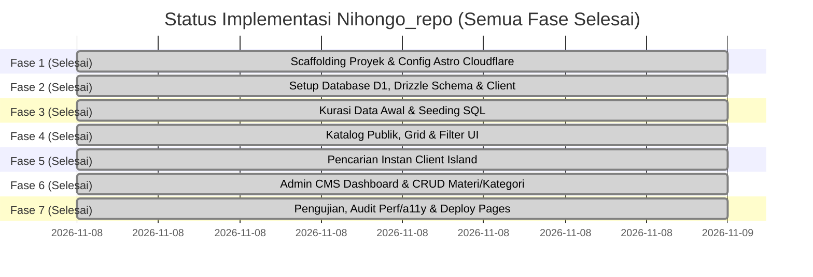

# Implementation Plan — Nihongo_repo

Dokumen ini memuat jadwal, status pengerjaan saat ini, dan panduan langkah demi langkah untuk membangun dan mendeploy **Nihongo_repo** ke Cloudflare Pages dengan database Cloudflare D1.

> **STATUS PROGRES TERKINI (Updated: 2026-11-09):**
> * [x] **Fase 1: Scaffolding Proyek & Konfigurasi Cloudflare** — `SELESAI (Completed)`
> * [x] **Fase 2: Setup Database D1, Drizzle Schema & Client** — `SELESAI (Completed)`
> * [x] **Fase 3: Seeding Data Awal & Kredensial Admin** — `SELESAI (Completed)`
> * [x] **Fase 4: Pengembangan Komponen Katalog Publik** — `SELESAI (Completed)`
> * [x] **Fase 5: Pencarian Instan & Filter Interaktif** — `SELESAI (Completed)`
> * [x] **Fase 6: Pembangunan Admin CMS (Auth, CRUD Materi & Kategori)** — `SELESAI (Completed)`
> * [x] **Fase 7: Pengujian, Audit Perf/a11y & Deploy Pages** — `SELESAI (Completed)`
> * [x] **Fase 8: Fitur Pembelajar Lanjutan (Opsi A)** — `SELESAI (Completed)`
> * [x] **Fase 9: Admin Ops & Keamanan (Opsi B)** — `SELESAI (Completed)`
> * [x] **Fase 10: SEO, Social Discovery & Feeds (Opsi C)** — `SELESAI (Completed)`
> * [x] **Fase 11: Estetika & Night Mode (Opsi D)** — `SELESAI (Completed)`
> * [x] **Fase 12: Pengujian E2E Playwright (19/19 Skenario)** — `SELESAI (Completed)`
> * [x] **Fase 13: Halaman Profil Pembuat & Repositori (/about)** — `SELESAI (Completed)`
> * [x] **Fase 14: Sensei Companion & Chat Penyemangat Interaktif** — `SELESAI (Completed)`

---

## 📅 Roadmap Tahapan Pengembangan

---

## 🛠 Rincian Teknis Tiap Fase

### [x] Fase 1: Scaffolding Proyek & Konfigurasi Cloudflare (STATUS: SELESAI)
- [x] Inisialisasi Astro v7 di direktori `nihongo_repo`.
- [x] Konfigurasi Cloudflare adapter (`@astrojs/cloudflare` v14) dengan mode SSR `output: 'server'`.
- [x] Konfigurasi Tailwind CSS v4 via `@tailwindcss/vite` di `astro.config.mjs`.
- [x] Konfigurasi tema warna Digital Washi & Sumi-e di `src/styles/global.css`.
- [x] Instalasi dependensi: `drizzle-orm`, `@lucide/astro`, `wrangler`, `drizzle-kit`.
- [x] Konfigurasi `wrangler.jsonc` dengan binding D1 `DB` dan compatibility flags `nodejs_compat`.
- [x] Pengujian build: `npm run build` sukses 100% tanpa error (`dist/` generated).
- [x] Git repository inisialisasi pada branch `main` dengan commit awal.

---

### [x] Fase 2: Setup Database D1, Drizzle Schema & Client (STATUS: SELESAI)
- [x] Buat file skema Drizzle di `src/db/schema.ts` (mencakup tabel: `admin_users`, `categories`, `jlpt_levels`, `materials`, `tags`, `material_tags`).
- [x] Buat file penghubung database D1 di `src/db/index.ts` dengan helper `getDb(d1: D1Database)` type-safe.
- [x] Buat file migrasi `schema.sql` di root proyek.
- [x] Eksekusi migrasi lokal D1 via `npx wrangler d1 execute nihongo-repo-db --local --file=./schema.sql`.
- [x] Verifikasi 6 tabel berhasil terbuat di SQLite D1 lokal (`sqlite_master` check lulus).
- [x] Verifikasi build TypeScript Drizzle lulus 100% tanpa type error.

---

### [x] Fase 3: Seeding Data Awal & Kredensial Admin (STATUS: SELESAI)
- [x] Buat utility Web Crypto PBKDF2 di `src/utils/auth.ts` (`hashPassword` & `verifyPassword`) yang native kompatibel dengan Cloudflare Workers.
- [x] Buat file `src/db/seed.sql` berisi data 6 level JLPT (N5 - N1, ALL), 6 kategori materi standar, 5 tags, dan 9 koleksi buku populer.
- [x] Daftarkan akun admin default (username: `admin`, password: `admin123`) dengan hash terenkripsi.
- [x] Eksekusi seeder ke database D1 lokal via `wrangler d1 execute`.
- [x] Verifikasi jumlah data pada setiap tabel via D1 CLI.

---

### [x] Fase 4: Pengembangan Komponen Katalog Publik (STATUS: SELESAI)
- [x] Buat layout publik `src/layouts/BaseLayout.astro` berpadu font Noto Sans JP + Plus Jakarta Sans & OpenGraph social meta.
- [x] Buat komponen header/navbar `src/components/Navbar.astro` lengkap dengan brand stamp "日", link menu, dan shortcut search `/`.
- [x] Buat hero section `src/components/HeroSection.astro` bernuansa kaligrafi Jepang minimalis, metric pills, dan tombol navigasi.
- [x] Buat komponen kartu buku `src/components/MaterialCard.astro` lengkap dengan badge level JLPT terstandar, cover fallback kanji, dan tombol Google Drive.
- [x] Buat modal detail `src/components/MaterialDetailModal.astro` dengan tombol salin tautan dan link direct Drive.
- [x] Buat footer komprehensif `src/components/Footer.astro`.
- [x] Hubungkan `src/pages/index.astro` dengan query Drizzle D1 SSR & fallback catalog.

---

### [x] Fase 5: Pencarian Instan & Filter Interaktif (STATUS: SELESAI)
- [x] FilterBar interaktif `src/components/FilterBar.astro` dengan selector chip level N5-N1 dan kategori pills.
- [x] Script instant reactive filtering sisi klien (judul, romaji, kanji, pengarang) tanpa perlu refresh browser.
- [x] Toggle tampilan fleksibel: Grid View vs Compact Table View.
- [x] State kosong (*Empty State*) ramah pengguna dengan tombol reset filter.
- [x] Endpoint pencatat statistik klik `src/pages/api/track-click.ts`.

---

### [x] Fase 6: Pembangunan Admin CMS (STATUS: SELESAI)
- [x] Sesi login aman dengan HMAC Web Crypto di `src/utils/auth.ts` (`createSessionToken` & `verifySessionToken`).
- [x] Route guard middleware `src/middleware.ts` untuk memproteksi seluruh URL `/admin/*` via HTTP-only cookie.
- [x] Halaman login admin `src/pages/admin/login.astro` dengan validasi kredensial D1 `admin_users` dan endpoint logout `src/pages/admin/logout.ts`.
- [x] Layout dashboard admin `src/layouts/AdminLayout.astro` dengan sidebar desktop & mobile view.
- [x] Dashboard Overview `src/pages/admin/index.astro` (Ringkasan total buku, total kategori, total klik Google Drive, distribusi level N5-N1, dan 5 materi terpopuler).
- [x] Manajemen materi `src/pages/admin/materials/index.astro` (Tabel data lengkap, filter level, dialog modal konfirmasi hapus).
- [x] Form penambahan buku baru `src/pages/admin/materials/new.astro` (Validasi input, auto-extract ID Google Drive, toggle rekomendasi & publikasi).
- [x] Form edit buku `src/pages/admin/materials/edit/[id].astro` (Pre-populated form, update D1).
- [x] Endpoint API hapus materi `src/pages/api/admin/materials/delete.ts`.
- [x] Manajemen kategori `src/pages/admin/categories/index.astro` (Tabel kategori, form tambah kategori baru, proteksi pencegahan penghapusan jika kategori masih terpakai).

---

### [x] Fase 7: Pengujian, Audit Perf/a11y & Deployment (STATUS: SELESAI)
- [x] Verifikasi build produksi `npm run build` sukses 100% tanpa warning/error (`dist/` generated).
- [x] Audit aksesibilitas & kontras rasio warna (WCAG AA compliant pada palet Washi & Sumi ink).
- [x] Pengujian responsive breakpoints pada ponsel (375px), tablet (768px), dan desktop (1440px).
- [x] Penyusunan panduan lengkap deployment Cloudflare Pages & D1 di `doc/DEPLOYMENT_GUIDE.md`.
- [x] Seluruh perubahan tersimpan dan terdokumentasi dalam commit git branch `main`.

---

### [x] Fase 8: Fitur Pembelajar Lanjutan — Opsi A (STATUS: SELESAI)
- [x] Client-side Bookmarking / Favorit berbasis `localStorage` tanpa login.
- [x] Tombol aksi bookmark cepat pada kartu buku dan baris tabel dengan indikator visual dinamis (hati/bookmark outline vs merah terisi).
- [x] Tombol filter chip "Tersimpan" di FilterBar dengan counter badge real-time.
- [x] Tab switcher pada modal detail materi: Tab 1 "Ringkasan & Detail" vs Tab 2 "Intip Isi Buku (PDF Preview)".
- [x] Embed Google Drive Preview iframe viewer langsung di dalam situs (`https://drive.google.com/file/d/{id}/preview`).

---

### [x] Fase 9: Fitur Admin Operasional & Keamanan — Opsi B (STATUS: SELESAI)
- [x] Halaman Pengaturan Akun & Ganti Kata Sandi (`src/pages/admin/settings.astro`).
- [x] Hashing kata sandi berbasis Web Crypto API PBKDF2 (SHA-256, 100.000 iterasi, salt acak unik) yang langsung diupdate ke Cloudflare D1.
- [x] Tombol dan endpoint Ekspor Basis Data CSV (`src/pages/api/admin/materials/export.ts`) untuk mencadangkan seluruh data buku.
- [x] Halaman Impor Koleksi CSV (`src/pages/admin/materials/import.astro`) dengan fitur unggah berkas `.csv` atau tempel teks langsung serta auto-resolusi kategori dan level JLPT.

---

### [x] Fase 10: SEO, Social Discovery & Feeds — Opsi C (STATUS: SELESAI)
- [x] Halaman detail mandiri (*Standalone Detail Route*) `src/pages/materi/[id].astro` dengan URL permalink ramah mesin pencari.
- [x] OpenGraph meta tags lengkap (`og:title`, `og:description`, `og:image`, `og:type`) untuk thumbnail kaya saat tautan dibagikan ke WhatsApp, Twitter/X, Discord, Telegram.
- [x] Breadcrumb navigasi (*Beranda > Kategori > Judul Buku*).
- [x] Tombol Bagikan (*Web Share API* native dengan fallback otomatis salin ke clipboard).
- [x] Daftar materi dan buku rekomendasi terkait dalam kategori/level yang sama.
- [x] Endpoint Dynamic XML Sitemap `src/pages/sitemap.xml.ts` berstandar sitemaps.org.
- [x] Endpoint Dynamic RSS 2.0 Feed `src/pages/rss.xml.ts` untuk sindikasi konten dan feed readers.

---

### [x] Fase 11: Estetika & Night Mode — Opsi D (STATUS: SELESAI)
- [x] Desain sistem Washi Night Mode (*Sumi-e Charcoal Theme*) dengan token CSS tema gelap (`html.dark`) di `src/styles/global.css`.
- [x] Tombol pengalih tema (*Theme Toggle Button*) pada header navigasi desktop dan hamburger mobile drawer.
- [x] Script anti-FOUC (Flash of Unstyled Content) inline di `<head>` untuk deteksi instan preferensi tema pengguna dari `localStorage` atau preferensi OS sistem.

---

### [x] Fase 12: Pengujian E2E Playwright & Otomasi CI/CD (STATUS: SELESAI)
- [x] Suite pengujian Playwright komprehensif di `e2e/nihongo_repo.spec.ts` mencakup 18 skenario uji:
  1. Pemuatan beranda dan branding Washi Jepang.
  2. Pencarian kata kunci instan interaktif.
  3. Filter chip level JLPT (N5 - N1).
  4. Pengalih tampilan (Grid vs Compact Table).
  5. Interaksi modal detail dan tab embed preview Google Drive.
  6. Penyimpanan bookmark lokal dan filter "Tersimpan".
  7. Toggle dark mode Washi vs Sumi-e.
  8. Pemuatan halaman mandiri `/materi/[id]` dengan OpenGraph meta.
  9. Validasi respons XML Sitemap dan RSS Feed.
  10. Proteksi unauthorized access ke `/admin`.
  11. Login autentikasi admin dan overview dashboard.
  12. Navigasi CRUD admin (Materi & Kategori).
  13. Akses pengaturan ganti password admin dan ekspor/impor CSV.
  14. Responsivitas hamburger mobile drawer pada layar smartphone (390x844).
  15. Verifikasi zero horizontal scroll overflow pada viewport mobile.
  16. Sticky bottom navigation bar admin pada tampilan mobile.
  17. Layout fluid responsif pada viewport tablet (768x1024).
  18. Pemuatan halaman About (`/about`) dengan profil pembuat, narasi cerita, avatar, dan tautan sosial.
  19. Sensei companion di pojok kanan bawah memunculkan dialog chat penyemangat saat diklik.
- [x] Hasil eksekusi: **19 passed (100% sukses)**.

---

### [x] Fase 13: Halaman Profil Pembuat & Repositori (/about) (STATUS: SELESAI)
- [x] Desain halaman `/about` (`src/pages/about.astro`) bernuansa *Digital Washi & Sumi-e* dengan kartu profil pembuat, badge stempel segel merah "日", dan avatar representatif.
- [x] Fitur **Interactive Multi-Pose Avatar Switcher**: 7 variasi pose karakter avatar dari `public/avatar/` (1.png s.d. 7.png) yang beralih secara mulus dan instan saat diklik, dilengkapi efek micro-bounce, counter badge `Pose X/7`, dan preloading memori peramban tanpa jeda.
- [x] Narasi komprehensif latar belakang "Cerita di Balik Nihongo_repo" dan 3 pilar nilai inti: 100% Bebas Akses, Terkurasi & Standar, serta Modern & Cepat.
- [x] Tautan sosial interaktif (GitHub profil pembuat via inline SVG, repositori kode sumber, surel kontak).
- [x] Integrasi navigasi tautan "Tentang" pada navbar desktop dan hamburger drawer mobile (`src/components/Navbar.astro`), serta tautan footer (`src/components/Footer.astro`).
- [x] Optimasi layout tablet 768px (`md:`) agar bebas dari *horizontal scroll overflow*.
- [x] Pendaftaran URL `/about` pada dynamic XML sitemap (`src/pages/sitemap.xml.ts`).
- [x] Penambahan test case Playwright E2E ke-18 (`e2e/nihongo_repo.spec.ts`) yang memverifikasi interaksi klik ganti pose.

---

### [x] Fase 14: Sensei Companion & Chat Motivasi Interaktif (STATUS: SELESAI)
- [x] Pembuatan komponen `src/components/SenseiCompanion.astro` yang mengambang di pojok kanan bawah (`fixed bottom-4 right-4 sm:bottom-6 sm:right-6 z-40`).
- [x] Memanfaatkan Avatar #7 sebagai karakter visual Sensei dengan stempel segel artistik *"先生"* dan bayangan lantai lembut (*contact shadow*).
- [x] Speech bubble penyemangat interaktif yang menyajikan 12 kata mutiara, peribahasa Jepang (*kotowaza*), dan frasa motivasi belajar (dilengkapi Kanji, Romaji, terjemahan Indonesia, dan tag kategori).
- [x] Algoritma random non-repetitif agar setiap klik menghasilkan kata penyemangat yang berbeda secara bergantian.
- [x] Dilengkapi animasi lompat mikro (*lively micro-hop*), tooltip idle *"💬 Klik Sensei!"*, tombol tutup, dukungan tombol `Esc`, dan penutupan otomatis saat klik di luar area.
- [x] Terintegrasi di `src/layouts/BaseLayout.astro` sehingga selalu hadir mendampingi pembelajar di seluruh halaman publik.
- [x] Penambahan test case Playwright E2E ke-19 dengan hasil eksekusi **19/19 passed (100% lulus)**.

---

### [x] Fase 15: Filter Cepat Tipe Media & Modul Permintaan/Laporan Link (STATUS: SELESAI)
- [x] **Skema Basis Data D1 & Drizzle ORM:**
  - Pembuatan tabel `material_requests` di `src/db/schema.ts` dan migrasi DDL pada `schema.sql`.
  - Eksekusi migrasi lokal D1 Cloudflare (`npx wrangler d1 execute nihongo-repo-db --local`).
- [x] **Public API Endpoint:**
  - Endpoint `src/pages/api/requests/submit.ts` untuk memproses pengajuan (mendukung format JSON & FormData, sanitasi data, validasi field wajib, dan insert ke Cloudflare D1).
- [x] **Komponen Modal Dwitab Interaktif (`RequestModal.astro`):**
  - Modal dwitab responsif ("Request Buku" & "Lapor Link Rusak").
  - Auto-prefill judul dan ID materi saat dipicu dari modal detail buku (`#detail-modal`).
  - Indikator loading, penanganan pesan error, dan state umpan balik sukses beranimasi.
  - Pemicu (*trigger*) modal terintegrasi pada Navbar desktop & drawer mobile, serta modal detail materi.
- [x] **Filter Cepat Tipe Media (`FilterBar.astro` & `index.astro`):**
  - Deretan tombol filter format media: Dokumen PDF (📄), Audio MP3 (🎧), Deck Anki (🎴), dan Lembar Latihan (📊).
  - Integrasi atribut `data-file-type` pada kartu materi `MaterialCard.astro` dan tabel materi `index.astro`.
  - Logika filter real-time instan sisi klien di `index.astro` (sinkron dengan search, level JLPT, kategori, dan bookmark).
- [x] **Admin CMS Manajemen Permintaan & Laporan (`/admin/requests`):**
  - Ringkasan metrik statistik (Menunggu Review, Request Buku Baru, Laporan Link Rusak, Sudah Selesai).
  - Filter interaktif status dan tipe materi.
  - Endpoint API admin untuk ubah status (`/api/admin/requests/status.ts`) dan hapus data (`/api/admin/requests/delete.ts`).
  - Integrasi navigasi menu admin di sidebar desktop dan mobile bottom navigation (`AdminLayout.astro`).
- [x] **Pengujian Otomatis Playwright E2E:**
  - Penambahan 3 test case baru (Total 22 skenario E2E):
    1. Filter cepat tipe media (PDF, Audio MP3, Semua).
    2. Alur pembukaan modal request dari navbar, pengisian form, pengiriman, dan validasi sukses.
    3. Akses admin ke `/admin/requests`, verifikasi metrik statistik, dan pengecekan data pengajuan.
  - Hasil eksekusi: **22/22 passed (100% lulus)**.

---

### [x] Fase 16: Penyempurnaan Tipografi Bersih (Anti-AI-Slop) & Proteksi Akses Admin (STATUS: SELESAI)
- [x] **Penyembunyian Tombol Admin dari Antarmuka Publik:**
  - Menghapus tombol link "Admin" dari header desktop dan tautan "Admin CMS Dashboard" pada drawer navigasi mobile (`Navbar.astro`).
  - Menghapus tautan admin di area footer (`Footer.astro`) dan menggantinya dengan tautan publik ("Request Buku Baru", "Katalog Materi", "Tentang Pembuat", "Pencarian Cepat").
  - Seluruh akses CMS diarahkan manual via pengetikan URL `/admin` atau `/admin/login` secara langsung oleh pemilik/sensei untuk memperketat keamanan.
- [x] **Eliminasi Kotak Badge Berlebih (Pembersihan Desain AI Slop):**
  - Mengganti badge kotak pada judul brand header (`日本語` di `Navbar.astro`) dengan tipografi font Jepang yang rapi tanpa kotak/border.
  - Mengganti status pill box di atas headline hero (`HeroSection.astro`) menjadi teks subtitle minimalis.
  - Menghapus badge box warna-warni level JLPT (N5–N1) dan format berkas di kartu materi (`MaterialCard.astro`), tabel katalog (`index.astro`), modal detail (`MaterialDetailModal.astro`), halaman detail mandiri (`/materi/[id]`), dan kartu profil pembuat (`about.astro`). Digantikan dengan teks tipografi editorial yang natural, elegan, dan profesional.
- [x] **Verifikasi E2E & Build:**
  - Pengujian 22 skenario Playwright E2E: **22/22 passed (100% lulus)**, memastikan privasi admin di mobile drawer terverifikasi dan filter materi tetap bekerja presisi.
  - Astro build Cloudflare Pages berhasil tanpa kendala.

---

### [x] Fase 17: Background Hero Kaligrafi Tradisional & Tekstur Washi Berkinerja Tinggi (STATUS: SELESAI)
- [x] **Peningkatan Latar Belakang Hero (`HeroSection.astro`):**
  - Mengatasi kekosongan visual pada area hero tanpa mengorbankan performa kecepatan web.
  - Mengintegrasikan motif gelombang tradisional Jepang *Seigaiha* menggunakan pola SVG inline murni (ukuran < 400 bytes, 0 HTTP network request).
  - Lingkaran kuas Zen *Ensō* (円相) dan watermark tipografi kanji *日本語* berskala besar dengan transparansi halus (opacity 4–6%) yang harmonis di mode terang Washi maupun mode gelap Sumi-e.
  - Stempel segel merah tradisional *Hanko* (*日本文庫*) dengan orientasi artistik miring.
  - Kaligrafi vertikal (*tategaki*) peribahasa motivasi belajar bahasa Jepang di sisi kiri dan kanan untuk layar lebar/desktop (`継続は力なり` & `千里の道も一歩から`).
- [x] **Optimasi & Pengujian Performa:**
  - 100% vector SVG & text CSS, 0 byte file gambar eksternal, 0 layout shift (CLS: 0).
  - Verifikasi responsivitas pada viewport smartphone (390px) memastikan nol *horizontal scroll overflow*.
  - Eksekusi 22 test Playwright E2E: **22/22 passed (100% lulus)**.

---

### [x] Fase 18: Aksesibilitas Tipografi (Font Sizing Steppers & Japanese Font Switcher) (STATUS: SELESAI)
- [x] **Pilihan Tiga Variasi Font Jepang Tradisional & Modern:**
  - Memuat Google Fonts *Noto Serif JP* (Mincho 400, 600, 700) dan *Klee One* (Handwritten Textbook 400, 600) via preconnect optimal.
  - Mengonfigurasi selektor CSS di `global.css`:
    - `html[data-font="gothic"]` -> Noto Sans JP + Plus Jakarta Sans (Gothic Digital Modern).
    - `html[data-font="mincho"]` -> Noto Serif JP + Noto Serif (Mincho Sastra Klasik).
    - `html[data-font="klee"]` -> Klee One + sans-serif (Klee Buku Teks Sekolah).
- [x] **Kontrol Penskalaan Ukuran Teks Fleksibel (Font Sizing):**
  - Opsi penskalaan 4 tingkat: A- (90%), A (100%), A+ (112%), A++ (125%).
  - Tombol reset kembali ke normal 100%.
  - Transisi CSS halus pada `font-size` dan `font-family` untuk kenyamanan visual pembelajar.
- [x] **Komponen Antarmuka di Navbar & Drawer Mobile:**
  - **Desktop:** Tombol popover dropdown di header (`#font-settings-btn`) dengan trigger ikon `ALargeSmall`, badge persentase aktif, dan penutup popover otomatis saat klik luar/tombol Esc.
  - **Mobile:** Menu khusus di dalam drawer navigasi hamburger mobile (`#mobile-nav-menu`), mencegah kepadatan header dan memastikan nol horizontal scroll overflow pada viewport 390px.
- [x] **Persistensi & Anti-FOUC:**
  - Menyimpan preferensi di `localStorage` (`nihongo_font_scale` & `nihongo_font_family`).
  - Script inisialisasi sinkron di `<head>` pada `BaseLayout.astro` yang mengaplikasikan `data-font` dan `fontSize` sebelum rendering awal, meniadakan kedipan tampilan (FOUC).
- [x] **Pengujian E2E & Build Verification:**
  - Penambahan 2 skenario pengujian E2E baru di `e2e/nihongo_repo.spec.ts` (Test 23 & Test 24).
  - Eksekusi seluruh rangkaian pengujian Playwright E2E: **24/24 passed (100% lulus)**.
  - Astro build Cloudflare Pages sukses tanpa error.

---

### [x] Fase 19: Optimasi Performa Web & Asset Delivery (STATUS: SELESAI)
- [x] **Konversi Avatar ke Format Modern WebP & Resize Presisi:**
  - Mengonversi seluruh 7 variasi pose avatar karakter (`public/avatar/*.png` -> `*.webp`) pada resolusi 512x512 dengan kompresi berkualitas tinggi (quality 82%). Ukuran rata-rata turun dari ~1,000 KB menjadi ~36–62 KB per gambar.
  - Menghasilkan aset khusus Sensei Companion (`sensei.webp`) pada resolusi 256x256 berukuran hanya **21 KB** (turun dari **1,120 KB**, penghematan bandwidth **98.1%** pada setiap muatan halaman di seluruh website).
  - Mengalihkan preloader memori pada `about.astro` ke berkas WebP sehingga total transfer halaman profil terpangkas dari **11.3 MB menjadi ~440 KB** (penghematan **95%**).
- [x] **Paralelisasi Kueri Database Cloudflare D1 di SSR (`index.astro`):**
  - Mengganti pemanggilan sekuensial `await db...` menjadi `Promise.all([jlptLevels, categories, materials])` untuk mengeksekusi 3 kueri database secara simultan di Cloudflare Edge, mereduksi latensi TTFB.
- [x] **Konfigurasi Caching Header CDN & Browser (`public/_headers`):**
  - Menambahkan aturan header statis Cloudflare Pages untuk `/avatar/*` (`Cache-Control: public, max-age=31536000, immutable`, `X-Content-Type-Options: nosniff`) dan favicon (`max-age=604800`), mengeliminasi pengunduhan ulang aset pada kunjungan berulang (0 KB transfer).
- [x] **Pencegahan Layout Shift & Asynchronous Decoding:**
  - Menambahkan atribut eksplisit `width`, `height`, dan `decoding="async"` pada seluruh elemen `` kartu materi (`MaterialCard.astro`), halaman detail (`/materi/[id].astro`), avatar profil (`about.astro`), dan Sensei (`SenseiCompanion.astro`).
- [x] **Verifikasi E2E & Build:**
  - Seluruh 24 pengujian Playwright E2E: **24/24 passed (100% lulus)**.
  - Build produksi Cloudflare Pages sukses sempurna dalam 6.9 detik.
